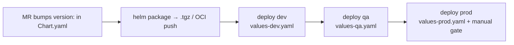

# Chart Testing & Promotion

**Goal:** a chart you can *prove* renders correctly before it ever reaches a
cluster — and a versioned path from dev to prod that doesn't rely on
"apply and see."

## The chart testing pyramid

```
helm lint            — syntax/schema sanity (free, always run)
helm template        — render locally, eyeball the diff (no cluster needed)
helm unittest        — assert rendered output as unit tests (CI gate)
helm test            — in-cluster smoke test pods (post-deploy verification)
conftest (OPA)       — policy assertions on rendered manifests (Phase 6 pairs)
```

## helm unittest — the missing layer most charts skip

`helm template | less` eyeballs output; helm-unittest *asserts* it. Install
as a plugin:

```bash
helm plugin install https://github.com/helm-unittest/helm-unittest
helm unittest todo-app/
```

The suite in `todo-app/tests/deployment_test.yaml` teaches the pattern:

| Assertion | What it guards |
|-----------|----------------|
| `equal spec.replicas: 1` | default replica contract |
| `image.tag: null` → `appVersion` | the default-tag fallback you *think* exists |
| `autoscaling.enabled` → `notExists spec.replicas` | the conditional block every chart ships but nobody tests — **replicas + HPA fighting is a real prod bug** |
| probe `port: tomcat` + `containerPort` | the service→container port contract |
| `matchRegex :0\.9\.7$` | the no-`:latest` values contract |

Run it in CI (the `gitlab-spring-app-flux` package stage is where this
plugs in): `helm unittest` failing = chart never packaged. That's the
shift-left version of "the chart applied but the probes were wrong."

## Promotion: version → dev → prod



The rules:

1. **Chart `version:` is the artifact version** — bump it every template
   change (semver); `appVersion:` is the app it ships. Confusing them in
   an interview is a tell.
2. **Same chart, per-env values** — promotion = the *same* `.tgz` +
   different `values-*.yaml`, never a rebuilt chart per env.
3. **Immutable promotion** — prod runs the exact artifact dev ran, pinned
   by chart version + image digest, not `latest`.
4. OCI registries (`helm push oci://...`) are the modern chart repo — see
   [solutions/helm-oci](../solutions/helm-oci.md).

## Deliberate break

- Set `autoscaling.enabled: true` + leave `replicas: 3` in values → the
  unittest `notExists spec.replicas` catches the conflict your eyes missed.
- Deploy prod with `tag: latest` → the regex test fails — the contract is
  enforced in the suite, not in a wiki page.
- Bump templates without bumping `version:` → a repackaged `.tgz` with the
  same version; caches and registries may serve the old artifact. Version
  bumps are not optional bookkeeping.

## Verify

- [ ] `helm unittest` runs green in CI on every chart change
- [ ] You can name what each pyramid layer catches that the layer below can't
- [ ] Promotion = same artifact + different values, stated in one sentence
